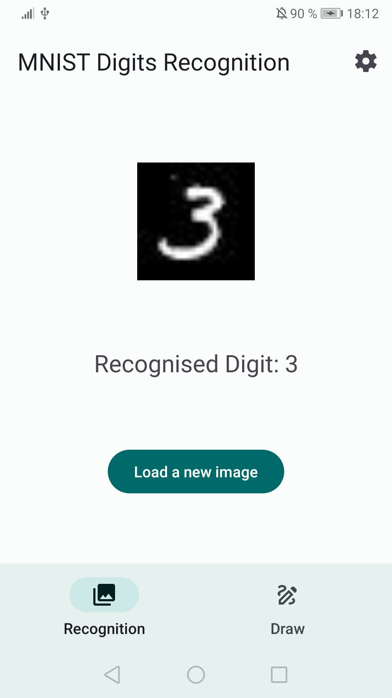
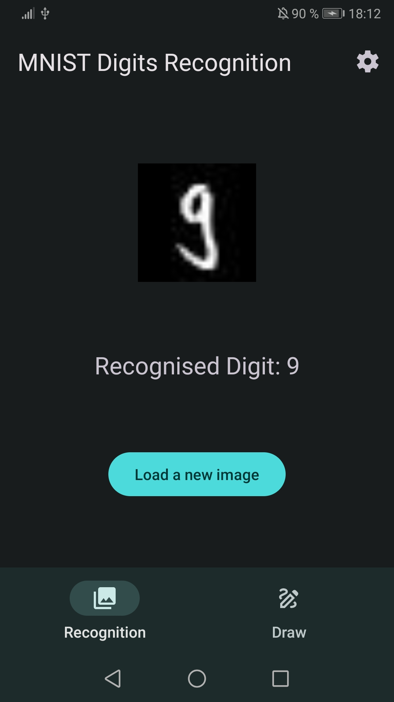
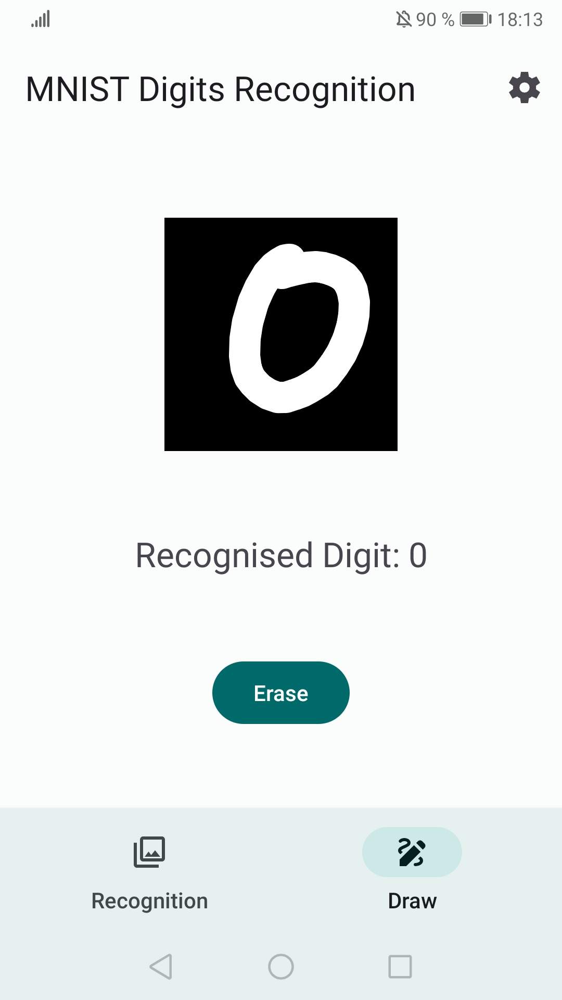
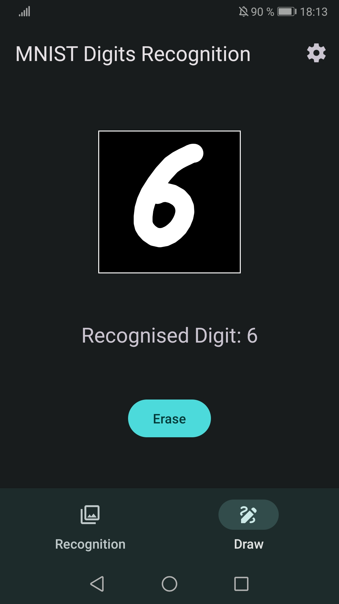

# Android MNIST Digits Recognition

This Android application allows you to use a ML model to recognise [MNIST handwritten digits](https://en.wikipedia.org/wiki/MNIST_database) taken from the official dataset (but not used during model training). You can also draw your own digits and have them recognised by the model!

This is using a [Convolutional Neural Network (CNN)](https://en.wikipedia.org/wiki/Convolutional_neural_network) model I made and trained using [PyTorch](https://pytorch.org/).  

## Download

- You can directly download the latest APK file available in the [Releases](https://github.com/b-brebion/android-mnist-digits-recognition/releases) tab and run it on your Android device.
- Or you can clone this repo using the command below, and then open the project in [Android Studio](https://developer.android.com/studio). You will then have the possibility to compile the app and launch it on your own Android device, or in an emulator.
```
git clone https://github.com/b-brebion/android-mnist-digits-recognition.git
```

## Model

```
CNN(  
    (conv1): Conv2d(1, 8, kernel_size=(3, 3), stride=(1, 1), padding=(1, 1))  
    (conv2): Conv2d(8, 16, kernel_size=(3, 3), stride=(1, 1), padding=(1, 1))  
    (pool): MaxPool2d(kernel_size=2, stride=2, padding=0, dilation=1, ceil_mode=False)  
    (fc1): Linear(in_features=784, out_features=400, bias=True)  
    (fc2): Linear(in_features=400, out_features=10, bias=True)  
    (dropout): Dropout(p=0.25, inplace=False)  
)
```
:white_check_mark: ~99% overall accuracy.

## Screenshots
### Recognition
 

### Draw
 
